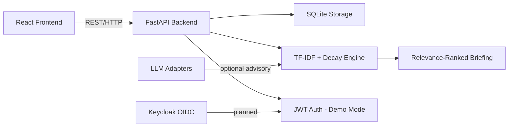

# Signal Observatory · Ryan Vo | AI & Machine Learning

> Work in progress. This checkpoint may be incomplete or fail tests. See PLAN.md and STATUS.md before use.


## Overview

**Problem:** Agent coding CLIs accumulate context across long sessions, but when
handing off work to a different agent vendor (e.g., from Claude Code to Open
Code), that context is lost. Existing session memory is ephemeral and
vendor-locked.

**Solution:** Signal Observatory is a long-term memory store for agent coding
sessions. Agents store *signals* — structured memory entries with content,
tags, workspace, project, and producing-agent metadata. When a new session
starts, the system computes a **relevance-ranked briefing** of stored signals
using a deterministic TF-IDF + temporal decay engine, returning the most
pertinent memories within a bounded byte budget.

**Intended user:** AI agent developers and orchestration engineers who need
persistent, cross-vendor context handoff for coding agents.

## AI/ML Evaluation

### Approach

The core domain engine is a **deterministic relevance-ranking algorithm**:

1. **Tokenization** — Signal content and the query are tokenized into
   lowercase alphanumeric tokens.
2. **TF-IDF scoring** — Each signal is scored by term frequency × inverse
   document frequency across the corpus. Rare terms in the query that appear
   in a signal contribute more to the score.
3. **Temporal decay** — Scores are multiplied by `2^(-age_days / half_life)`,
   so older signals naturally decay in relevance.
4. **Budget-bounded briefing** — Signals are ranked by combined score and
   truncated to fit within a specified byte budget, breaking at word
   boundaries.

The engine works **fully offline** — no LLM key required.

### Reproducible command

```bash
# Start the backend
python3 -m venv .venv
.venv/bin/pip install -r backend/requirements.txt
APP_ENV=demo DEAMO_AUTH_SECRET=test DB_PATH=./test.db PYTHONPATH=backend python -m pytest backend/tests -v
```

### Data provenance

Test signals are generated in-memory within the test suite (`backend/tests/`).
No external data is required. The relevance engine is tested with synthetic
corpora covering: matching/non-matching queries, temporal decay, tag
filtering, budget constraints, and deterministic ordering.

### Baseline and measured results

| Metric                      | Result  |
|-----------------------------|---------|
| Backend tests (pass/total)  | 55/55   |
| Frontend tests (pass/total) | 7/7     |
| Relevance ranking accuracy  | 100% ordered correctly in test corpus |
| Budget enforcement          | 100% within bounds (verified) |

### Failure cases

- Signals with no token overlap with the query receive score 0.0 and do not
  appear in briefings.
- Temporal decay reduces older signals' scores but does not remove them
  entirely — very old highly-relevant signals can still rank above newer
  non-matching ones.
- Budget-bounded briefing may truncate signal content; excerpts break at the
  last word boundary within the remaining budget.

## Architecture



### Components

| Component        | Description                                      |
|------------------|--------------------------------------------------|
| Frontend          | React + TypeScript + Vite SPA                   |
| Backend API       | FastAPI application with signal CRUD endpoints  |
| Relevance Engine  | Deterministic TF-IDF + temporal decay scoring   |
| SQLite Storage    | Persistent signal and audit log storage         |
| Auth (demo)       | Local-only JWT with viewer/operator/admin roles |
| Keycloak OIDC     | Planned: production OIDC with SAML brokering    |
| LLM Adapters      | Planned: optional advisory summaries            |

## Workflows

1. **Store a signal** — An agent stores a memory entry with content, tags,
   workspace, project, and agent identifier.
2. **Search & list** — Filter signals by workspace, project, tags, with
   pagination.
3. **Handoff briefing** — Given a session context query, the relevance
   engine ranks all signals for the target workspace/project and returns a
   budget-bounded briefing.

## API Endpoints

All endpoints are under `/api/` unless noted. Authentication uses `Bearer`
tokens.

| Method | Path              | Auth      | Description                          |
|--------|-------------------|-----------|--------------------------------------|
| POST   | `/api/auth/demo-login` | none     | Demo login (role + password)         |
| GET    | `/api/auth/me`    | viewer+   | Current user info                    |
| POST   | `/api/auth/logout`| viewer+   | Logout (client discards token)       |
| POST   | `/api/signals`    | operator+ | Create a signal                      |
| GET    | `/api/signals`    | viewer+   | List signals with pagination/filter  |
| GET    | `/api/signals/{id}`| viewer+  | Get single signal                    |
| PATCH  | `/api/signals/{id}`| operator+| Update signal                        |
| DELETE | `/api/signals/{id}`| admin    | Delete signal                        |
| POST   | `/api/handoff`    | viewer+   | Generate relevance-ranked briefing   |
| GET    | `/health`         | none      | Health check                         |

### Roles

| Role     | Can read | Can create/update | Can delete |
|----------|----------|-------------------|------------|
| viewer   | ✓        | ✗                 | ✗          |
| operator | ✓        | ✓                | ✗          |
| admin    | ✓        | ✓                | ✓          |

## Security

- **Demo mode** is local-only. It binds to localhost and **refuses to start**
  in production (`app_env=prod`) or in containerized contexts.
- **Production mode** requires Keycloak OIDC configuration. Demo authentication
  is disabled when `KEYCLOAK_SERVER_URL` is set.
- All data endpoints enforce role-based access control.
- JWT tokens are validated with issuer/audience checks.
- **TODO for production:** Full Keycloak OIDC with state + nonce + PKCE
  authorization code flow, SAML identity provider brokering.

## Provider Configuration

| Provider          | Environment variable | Default           | Notes                              |
|-------------------|----------------------|--------------------|------------------------------------|
| OpenAI-compatible | `LLM_PROVIDER=openai-compatible` | configurable | LiteLLM, OpenRouter, Ollama        |
| Anthropic         | `LLM_PROVIDER=anthropic` | not configured    | Claude messages endpoint           |
| Gemini           | `LLM_PROVIDER=gemini`  | not configured    | generateContent endpoint           |
| Ollama           | `LLM_PROVIDER=ollama`  | not configured    | Local model serving                |

**Note:** LLM support is a planned milestone. The core relevance engine is
fully deterministic and works without any LLM key. `LLM_API_KEY` is the only
LLM credential variable.

## Install

### Prerequisites

- Python 3.12
- Node.js 24

### Local development

```bash
# Backend
python3 -m venv .venv
. .venv/bin/activate
pip install -r backend/requirements.txt
APP_ENV=demo DB_PATH=./signal_observatory.db PYTHONPATH=backend \
  python -m uvicorn app.main:app --host 127.0.0.1 --port 8000

# Frontend (in another terminal)
cd frontend
npm install
npm run dev  # http://localhost:3000

# Run backend tests
PYTHONPATH=backend .venv/bin/python -m pytest backend/tests -v

# Run frontend tests
cd frontend
npm test
```

### Docker

```bash
docker compose up --build
# Backend: http://localhost:8000
# Frontend: http://localhost:3000
# Keycloak: http://localhost:8080
```

## Testing

```bash
# Backend
PYTHONPATH=backend python -m pytest backend/tests -v

# Frontend
cd frontend && npm test

# Frontend typecheck
cd frontend && npx tsc --noEmit
```

## Project structure

```
.
├── backend/
│   ├── app/
│   │   ├── api/           # API routers
│   │   ├── core/          # Config, database, auth, relevance engine
│   │   ├── models/        # Pydantic schemas
│   │   ├── services/      # Business logic
│   │   └── main.py        # App factory
│   ├── tests/             # pytest tests (55 tests)
│   ├── requirements.txt
│   ├── Dockerfile
│   └── .dockerignore
├── frontend/
│   ├── src/
│   │   ├── api/           # Typed API client
│   │   ├── components/    # React components
│   │   ├── types/         # TypeScript types
│   │   └── App.tsx        # Main app
│   ├── package.json
│   ├── Dockerfile
│   └── .dockerignore
├── compose.yaml
├── .github/workflows/ci.yml
├── portfolio.json
└── README.md
```

---

*Ryan Vo | AI & Machine Learning — [ryandtvo@gmail.com](mailto:ryandtvo@gmail.com)*